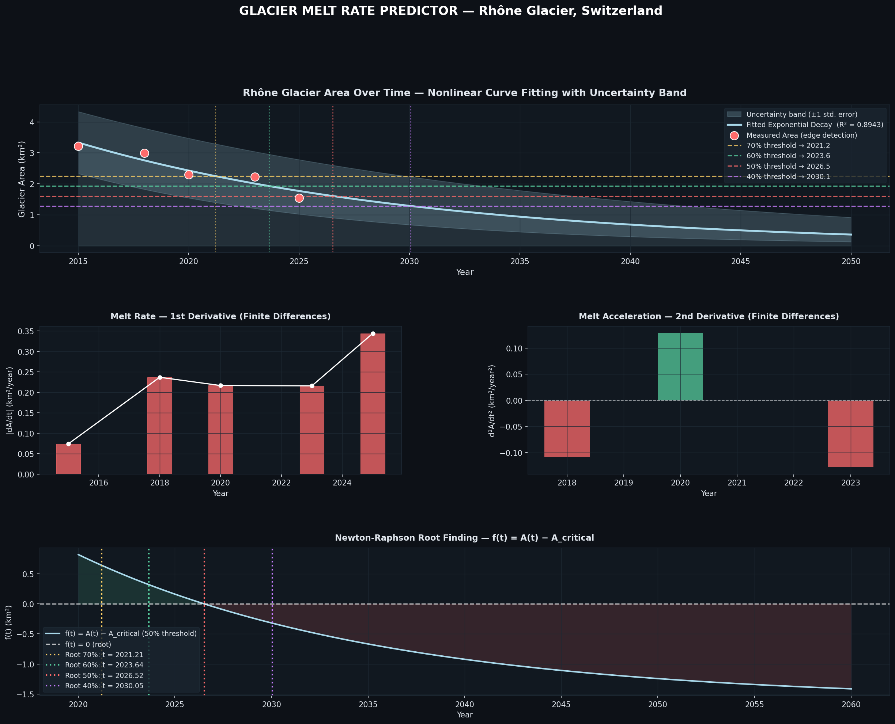

# Rhône Glacier Melt Predictor

A Numerical Analysis project that measures the shrinking tongue of the Rhône Glacier (Switzerland) in satellite images from 2015 to 2025, fits a decay model to the measured areas and estimates when the glacier will fall below set fractions of its 2015 area.



## Method

1. **Edge detection and area extraction.** Each image is cropped to the glacier tongue. Ice pixels are classified with an HSV threshold (medium brightness, low saturation) and a blue-grey test (blue channel ≥ red channel). Morphological opening and closing clean up the mask, and the pixel count gives the area. The 2015 image also gets a Canny edge overlay (CLAHE + Gaussian blur + Canny) to show where the boundary is. Images from the same year are averaged.
2. **Nonlinear curve fitting.** The model is the exponential decay `A(t) = a·exp(−b·(t − 2015)) + c`, fitted by least squares (`scipy.optimize.curve_fit`). The shaded band shows how the curve moves when each parameter is shifted by ±1 standard error of its fit. It is not a statistical confidence interval.
3. **Finite differences.** The observation years are unevenly spaced, so interior points use three-point formulas for uneven steps, with `h₁ = tᵢ − tᵢ₋₁` and `h₂ = tᵢ₊₁ − tᵢ`:

   - Melt rate: `A'(tᵢ) ≈ [h₁²·Aᵢ₊₁ − h₂²·Aᵢ₋₁ + (h₂² − h₁²)·Aᵢ] / [h₁·h₂·(h₁ + h₂)]`
   - Acceleration: `A''(tᵢ) ≈ 2·[(Aᵢ₊₁ − Aᵢ)/h₂ − (Aᵢ − Aᵢ₋₁)/h₁] / (h₁ + h₂)`

   At the endpoints, the melt rate uses one-sided differences and the acceleration is left undefined.
4. **Newton–Raphson.** For each threshold (70%, 60%, 50% and 40% of the 2015 area), the script solves `f(t) = A(t) − A_critical = 0`. If the fitted asymptote `c` is at or above a threshold, the curve never reaches that threshold. The script then reports "not reached under this model" and leaves it out of the plots.

## Results

| Quantity | Value |
|---|---|
| 2015 area | 3.215 km² |
| 2025 area | 1.544 km² |
| Area lost 2015 → 2025 | 52.0% |
| Fitted decay rate `b` | 0.0633 /yr (≈ 6.1% per year) |
| Fitted asymptote `c` | 0 km² |
| R² | 0.894 |

| Threshold (fraction of 2015 area) | Area | Year crossed (model) |
|---|---|---|
| 70% | 2.250 km² | 2021.2 |
| 60% | 1.929 km² | 2023.6 |
| 50% | 1.607 km² | 2026.5 |
| 40% | 1.286 km² | 2030.1 |

The model curve crosses the 70% and 60% thresholds inside the observed period, so those two years are interpolated from the fit. Only the 50% and 40% years are forecasts. The fit put the asymptote at its lower bound of 0, so the model reduces to plain exponential decay toward zero.

The `outputs/` folder also holds the Canny visualization (`canny_2015_visualization.jpg`) and one classification overlay per year (`debug_<year>.jpg`).

## How to run

```bash
pip install -r requirements.txt
python glacier_melt_predictor.py
```

This needs Python 3.10 or later. All generated images go to `outputs/`. The script prints each step to the console, including the Newton–Raphson iteration tables, and then opens the results plot.

## Image source

Late-summer satellite images of the Rhône Glacier (2015–2025), collected manually for a course project. The dates are in the file names under `images/`.

## Limitations

- **Few data points.** After same-year images are averaged, only 5 time points remain, so the three fitted parameters are poorly constrained.
- **Long extrapolation.** The fitted curve is drawn decades past the last observation, but nothing in the data shows that exponential decay holds that far ahead.
- **Approximate scale.** The pixel-to-km² conversion assumes each image covers about 18 km × 12 km. Absolute areas are therefore approximate, while the relative changes are more reliable.
- **Seasonal snow.** Snow cover and lighting change between acquisition dates, and the colour-based classification can count snow as ice or miss ice. The three 2023 images (22 Aug, 24 Aug, 26 Sep) range from 2.90 to 1.45 km², which shows how large this effect can be.
